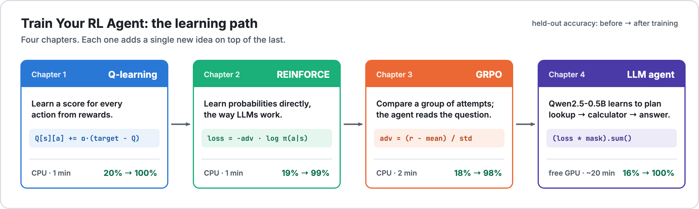
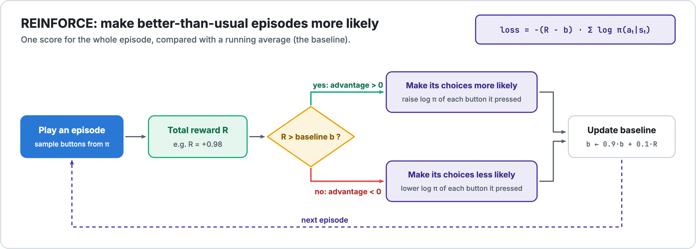
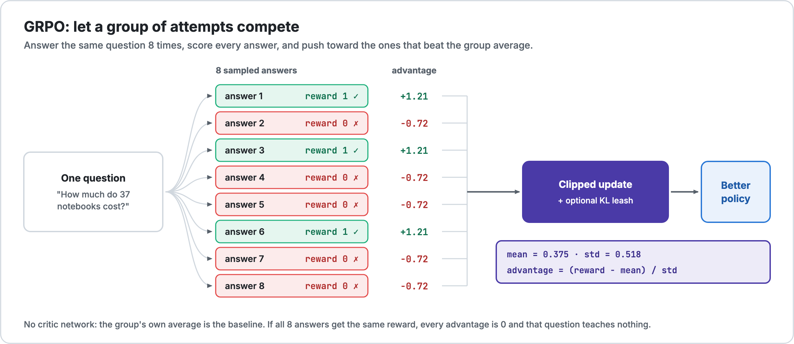
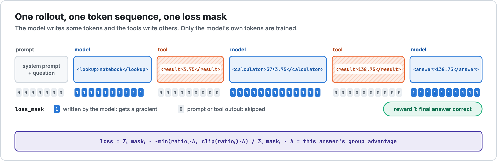
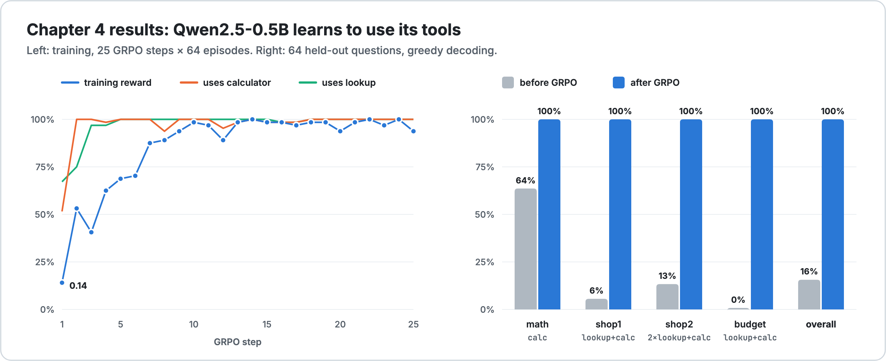

<div align="center">

# 🧠 Train Your RL Agent

### Agentic Reinforcement Learning from scratch, for beginners

**From a 6-row scoreboard to an LLM that learns to use tools, in 4 small notebooks you can run for free.**

[](https://github.com/HamedKhosravi99/TrainYourAgent/actions/workflows/ci.yml)
[](LICENSE)


[](https://colab.research.google.com/github/HamedKhosravi99/TrainYourAgent/blob/main/notebooks/01_q_learning_tool_agent.ipynb)



</div>

Reinforcement learning with checkable rewards is how reasoning models like DeepSeek-R1 were trained. **Agentic RL** takes the same recipe further: the model learns to **use tools, plan over several steps, and act on what the tools return**, as in Search-R1 and ReTool. But most code that does this lives inside huge frameworks, and most tutorials assume you already know RL.

**Train Your RL Agent starts from zero.** Each chapter adds **one big idea** on top of the last, keeps every line of code visible, and runs on a laptop CPU or a free Colab GPU. By the end, you'll have trained a real LLM to plan *look up a price → calculate → answer* with **GRPO you wrote yourself**.

<div align="center">

**"How much do 15 backpacks and 95 erasers cost in total?"** (correct answer: 499.25)

<table>
<tr><th>❌ Before RL: Qwen2.5-0.5B-Instruct as downloaded</th><th>✅ After 25 GRPO steps (17 min on a laptop)</th></tr>
<tr><td valign="top">

```xml
<lookup>backpack</lookup>
<result>27.90</result>
<lookup>eraser</lookup>
<result>0.85</result>
<answer>28.75</answer>
```

It looks up both prices, then just adds them.<br>It never multiplies by the quantities.

</td><td valign="top">

```xml
<lookup>backpack</lookup>
<result>27.90</result>
<lookup>eraser</lookup>
<result>0.85</result>
<calculator>15 * 27.90 + 95 * 0.85</calculator>
<result>499.25</result>
<answer>499.25</answer>
```

Look up → plan the arithmetic → answer.<br>It learned this from a 0/1 reward alone.

</td></tr>
</table>

</div>

---

## 🪜 The learning path

| # | Chapter | The one big idea | You'll see | Runs on | Open |
|:-:|:--|:--|:--|:--|:-:|
| 1 | **Q-learning tool agent** | Learn a *score* for each action from rewards; plan two steps ahead | A tiny agent learns *right tool → Finish*: **20% → 100%** on unseen tasks | CPU · ~1 min | [](https://colab.research.google.com/github/HamedKhosravi99/TrainYourAgent/blob/main/notebooks/01_q_learning_tool_agent.ipynb) |
| 2 | **Policy gradients (REINFORCE)** | Learn *probabilities* directly, the way LLMs work: `loss = -(advantage * log_prob)` | Probabilities sharpen from 25% to ~100%; why a **baseline** matters (71% vs 98% in our tests) | CPU · ~1 min | [](https://colab.research.google.com/github/HamedKhosravi99/TrainYourAgent/blob/main/notebooks/02_policy_gradient_reinforce.ipynb) |
| 3 | **GRPO from scratch** | Compare a **group** of attempts, **clip** updates, add a **KL leash**; the agent now *reads* the question | **18% → 98%** on unseen phrasings, plus experiments on every GRPO knob | CPU · ~2 min | [](https://colab.research.google.com/github/HamedKhosravi99/TrainYourAgent/blob/main/notebooks/03_grpo_from_scratch.ipynb) |
| 4 | **Agentic RL for a real LLM** | Multi-turn **tool calls** inside rollouts, a **loss mask** for tool output, **LoRA** from scratch | Qwen2.5-0.5B learns lookup + calculator: **16% → 100%** on held-out questions | free T4 GPU · ~20 min | [](https://colab.research.google.com/github/HamedKhosravi99/TrainYourAgent/blob/main/notebooks/04_llm_tool_use_grpo.ipynb) |

**Who is this for?** Students, engineers and researchers who've heard "GRPO", "agentic RL" or "RL for LLMs" and want to really understand it. You need basic Python. No RL background is assumed, and chapters 1–3 don't even need a GPU.

---

## 🚀 Quick start

**Option A: in your browser (recommended).** Click a Colab badge above and press *Runtime → Run all*. Chapters 1–3 work on the free CPU runtime. For Chapter 4, pick *Runtime → Change runtime type → T4 GPU* first.

**Option B: on your machine.**

```bash
git clone https://github.com/HamedKhosravi99/TrainYourAgent.git
cd TrainYourAgent
pip install -r requirements.txt
jupyter notebook notebooks/
```

**Option C: Chapter 4 as a single script** (GPU, or an Apple-silicon Mac):

```bash
python scripts/train_tool_agent.py              # Qwen2.5-0.5B-Instruct, 25 GRPO steps
python scripts/train_tool_agent.py --tool-cost 0.02   # also charge a small price per tool call
python scripts/train_tool_agent.py --steps 3 --eval-size 8 --questions-per-step 2   # quick smoke test
```

---

## 🔍 What's inside each chapter

### Chapter 1 · Q-learning: a scoreboard that learns

An assistant has four buttons (**Calculator**, **Dictionary**, **Reply**, **Finish**) and must learn *which tool to use* and *when to stop*. It keeps a **Q-table** with a score for every (situation, button) pair and improves it with the classic update:

```python
better_guess = points + 0.9 * max(Q[next_state].values())   # reward now + best future
Q[state][button] += 0.25 * (better_guess - Q[state][button])
```


### Chapter 2 · REINFORCE: from scores to probabilities

LLMs don't keep scores. They output **probabilities**. So we replace the table with a softmax **policy** and learn it with the line that sits at the heart of every RL-for-LLMs method:

```python
advantage = total_reward - baseline
loss = -(advantage * log_probs.sum())    # better-than-usual episodes become more likely
loss.backward(); optimizer.step()
```



An experiment shows why the **baseline** matters. Give every episode +3 "free points", and without a baseline the agent reinforces its mistakes too (71% vs 98% after 300 rounds, averaged over 20 seeds).

### Chapter 3 · GRPO: the algorithm behind DeepSeek-R1



The agent now **reads the question** with a tiny neural network (bag-of-words → MLP), and we implement **GRPO** piece by piece:

```python
advantage = (reward - group.mean()) / group.std()          # 👥 compare siblings
ratio     = exp(new_logp - old_logp)
objective = min(ratio * A, clip(ratio, 0.8, 1.2) * A)      # ✂️ don't move too far
kl        = exp(ref_logp - new_logp) - (ref_logp - new_logp) - 1   # 🪢 stay close to the start
loss      = (-objective + beta * kl).mean()
```

Then you run experiments on each knob: group size, KL strength, clipping, and step size. Some honest findings from our runs: a tight KL leash (β=1) blocks learning (≈50%), no leash is fine on this task, and clipping helps a little but can't rescue a learning rate that's too high.

### Chapter 4 · A real LLM learns to use tools

A **shop assistant** built on **Qwen2.5-0.5B-Instruct** gets two tools: a price `lookup` (the prices are invented, so the model *can't* know them) and a `calculator`. The reward is 1 only if the final number is exactly right. **We never reward tool use itself.**



Everything is written from scratch in PyTorch + 🤗 `transformers`, **without TRL, verl or peft**:

| Piece | What it does | Lines |
|:--|:--|:-:|
| `rollout()` | Batched multi-turn generation: stop at `</lookup>`/`</calculator>`, run the tool, paste `<result>`, continue | ~45 |
| loss mask | `1` for tokens the model wrote, `0` for tokens the tool wrote, so we never train on tool output | built into `rollout()` |
| `group_advantages()` | GRPO's group-relative baseline | 3 |
| `grpo_loss()` | Clipped, token-level policy-gradient loss with an optional KL leash | 8 |
| `LoRALinear` | Low-rank adapters from scratch; switching them off gives a free KL reference model | 13 |

**Results** (64 held-out questions, greedy decoding, 25 GRPO steps × 64 episodes):



| Question type | Example | Before | After |
|:--|:--|:-:|:-:|
| `math` | *A farmer plants 347 rows of trees with 58 trees in each row...* | 64% | **100%** |
| `shop1` | *How much do 37 notebooks cost?* | 6% | **100%** |
| `shop2` | *How much do 37 notebooks and 12 rulers cost in total?* | 13% | **100%** |
| `budget` | *I have 300 dollars and buy 41 markers. How much is left?* | 0% | **100%** |
| **overall** | | **16%** | **100%** |

Measured on an Apple M4 laptop (about 17 minutes in total). Held-out questions use new numbers and item combinations but the same question templates. The notebook's *honest scope* section spells out what this does and doesn't show.

**🕵️ Plot twist: 100% accurate, but not efficient.** Look closer and the agent makes tool calls it doesn't need. Before a pure math question it looks up a word like `tree` (→ `unknown item`) and only then calculates. The reward only checks the final answer, so extra calls were free. **RL optimizes exactly what you reward.** Habits also vary from run to run. Here are three of our 25-step runs, all at 100% held-out accuracy:

| Tool calls per question | run A, no cost | run B, no cost | run C, `--tool-cost 0.02` | fewest possible |
|:--|:-:|:-:|:-:|:-:|
| `math` | 2.8 | 2.1 | 2.0 | 1 |
| `shop1` | 2.7 | 2.0 | **2.0** | 2 |
| `shop2` | 3.0 | 3.0 | **3.0** | 3 |
| `budget` | 3.0 | 2.0 | **2.0** | 2 |

In run A the agent settled into a *lookup → lookup → calculator* ritual on nearly every question. Charging a small price per tool call (the same −0.02 idea as Chapter 1) gave the fewest possible calls on every shop question in run C, but the reflexive math lookup survived all three runs. The notebook also explains why the cost made training bumpier: GRPO's group normalization turns tiny reward differences into big pushes. These are single runs, not seed averages.

---

## 🗺️ Concept map: toy → LLM

| Idea | Toy agent (Ch 1–3) | LLM agent (Ch 4) |
|:--|:--|:--|
| Action | press one of 4 buttons | write one of ~150k tokens |
| Episode | a few button presses | a whole answer with tool calls and results |
| Observation | topic label (Ch 1–2), question words (Ch 3) | the full token sequence so far |
| Policy | Q-table → softmax table → tiny MLP | Qwen2.5-0.5B + LoRA |
| Reward | +1 / −1 with small step costs | 1 if the final number is right, else 0 |
| Learning rule | Q-learning → REINFORCE → GRPO | GRPO with a loss mask |
| Reference for KL | frozen copy of the start | the same model with LoRA switched off |

---

## 📁 Repository layout

```
TrainYourAgent/
├── notebooks/
│   ├── 01_q_learning_tool_agent.ipynb      # CPU · scoreboard agent
│   ├── 02_policy_gradient_reinforce.ipynb  # CPU · policy gradients + baselines
│   ├── 03_grpo_from_scratch.ipynb          # CPU · GRPO on a text-reading agent
│   └── 04_llm_tool_use_grpo.ipynb          # GPU · Qwen2.5-0.5B learns lookup + calculator
├── scripts/
│   └── train_tool_agent.py                 # Chapter 4 as one self-contained script
├── tests/
│   └── test_tool_agent.py                  # tools, reward, masking, GRPO loss, LoRA
├── assets/                                 # diagrams (regenerate with assets/src/diagrams.py)
└── requirements.txt
```

The Chapter 4 notebook's code cells are copied from `scripts/train_tool_agent.py`, so the notebook and the script always do the same thing. CI runs the unit tests and executes Chapters 1–3 end to end on every push.

---

## ❓ FAQ

**Is this "real" RL, or a simulation of it?**
It's real RL. Chapters 1–3 use classic algorithms on a small simulated world. Chapter 4 trains a real 0.5B-parameter LLM with GRPO, the same algorithm family used for DeepSeek-R1, using real tool execution inside the rollouts.

**Why not just use TRL / verl?**
They're great for scale, and we link to them at the end. But they hide the loop you're here to understand. Here, the whole Chapter 4 training loop fits in one file you can read in an evening.

**Do I need a GPU?**
Only for Chapter 4. A free Colab T4 is enough, and an Apple-silicon Mac works too (slower). Chapters 1–3 run on any CPU in a minute or two.

**Can I use another model?**
Yes. Change `MODEL_NAME` / `--model` to any small chat model with a chat template (for example a 1.5B or 3B model on a larger GPU). The code doesn't change.

**Why LoRA instead of full fine-tuning?**
It needs ~4x less memory, so it fits on free GPUs. It also gives a free reference model for the KL leash. [Recent experiments](https://thinkingmachines.ai/blog/lora/) found that LoRA matches full fine-tuning for policy-gradient RL.

---

## 📚 Further reading

- Sutton & Barto, [*Reinforcement Learning: An Introduction*](http://incompleteideas.net/book/the-book-2nd.html) (free online)
- Shao et al., [DeepSeekMath](https://arxiv.org/abs/2402.03300) (introduces **GRPO**) · DeepSeek-AI, [DeepSeek-R1](https://arxiv.org/abs/2501.12948)
- Schulman et al., [PPO](https://arxiv.org/abs/1707.06347) (where the clipped objective comes from)
- Yu et al., [DAPO](https://arxiv.org/abs/2503.14476) · Liu et al., [Dr. GRPO](https://arxiv.org/abs/2503.20783) (modern GRPO tweaks)
- Jin et al., [Search-R1](https://arxiv.org/abs/2503.09516) · Feng et al., [ReTool](https://arxiv.org/abs/2504.11536) (RL with tools in the loop)
- Hu et al., [LoRA](https://arxiv.org/abs/2106.09685) · Thinking Machines, [LoRA Without Regret](https://thinkingmachines.ai/blog/lora/)

---

## 🤝 Contributing

Issues and pull requests are very welcome, especially:

- 🧪 new **environments** for Chapter 4 (a calendar agent, a unit converter, a search tool...)
- 🌍 **translations** of the notebooks
- 🐛 places where a beginner got stuck (that's a bug in the tutorial, not in you!)

Please run `pytest tests` before opening a PR.

**Ideas on the roadmap:** a PPO chapter with a learned critic · multi-turn conversations with a simulated user · a bigger model with vLLM-powered rollouts.

---

## 📝 Citation

If this helped your course, blog post or research, a citation or a ⭐ helps other beginners find it.

```bibtex
@misc{trainyouragent2026,
  title  = {Train Your RL Agent: Agentic Reinforcement Learning from Scratch, for Beginners},
  author = {Khosravi, Hamed},
  year   = {2026},
  url    = {https://github.com/HamedKhosravi99/TrainYourAgent}
}
```

Released under the [MIT License](LICENSE).
